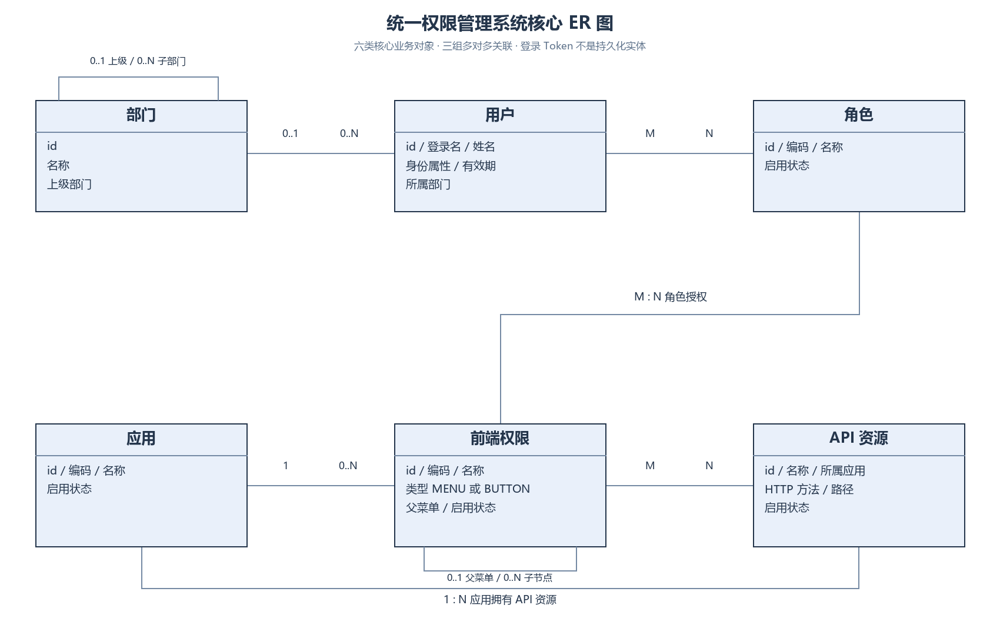

# 统一权限管理系统

Cdwy小组的面向对象分析与设计课程项目。本分支按照老师第一次检查意见整理为基础RBAC0系统：用户通过角色获得菜单/按钮权限，再由显式关联控制后端API访问。

**小组成员：温家正、姚景云、杜奕含、陈浩贤**

## 当前版本

| 项目 | 说明 |
|---|---|
| 本轮范围 | Token登录、用户/部门/角色/应用管理、菜单按钮树、独立API资源、三组授权关系 |
| 后端 | Java21、Spring Boot4.0.8、Spring Data JPA、Spring Security、JJWT、CloneFactory |
| 前端 | Vue3、TypeScript、Tailwind CSS、Vite；与后端同源发布 |
| 组织方式 | 先分层，再在各层按8组领域职责分包；10个Spring Service |
| 数据模型 | 六类核心概念对象、10张持久化表、12个外键；无登录会话表 |
| 认证 | Authorization: Bearer JWT；权限每次请求实时计算 |
| 默认运行配置 | H2内存、127.0.0.1:18081；重启清空演示数据 |
| 持久化配置 | 提供MySQL8新库DDL和prod validate配置；真实MySQL待验证 |
| 整改来源与交付 | 参考基线 Gitee d2f2438；GitHub main 为当前交付版本 |

本仓库当前版本为第一次检查整改版，包含完整前后端源码、需求说明、API设计、数据库设计、设计图和测试。旧版材料保存在[归档目录](docs/archive/20261028/README.md)，部署环境与验证范围见[运行说明](docs/first-review/demo.md)。

## 主要功能

- 管理员维护用户、部门树、应用和角色；外部/临时人员复用用户模型，期限上限可配置。
- 菜单、按钮构成前端权限树，API资源独立记录所属应用、HTTP方法与路径。
- 用户→角色、角色→前端权限、前端权限→API资源分别维护M:N关系，重复建立幂等。
- 用户、角色、应用、前端权限、API资源的启停使用独立接口，普通编辑不能夹带状态。
- 业务接口同时校验Token、账号、有效角色、权限与API绑定；管理员身份不自动获得业务权限。
- 普通用户查看本人权限树、修改密码；课程列表接口用于演示鉴权，数据明确标记为示例。

登录签发JWT，不建立服务端登录会话。改密和账号状态变化通过账号级credentialVersion使旧Token失效；退出仅删除本标签页Token。多角色取并集，无角色继承、互斥或行级权限。

## 构建与启动

先停止正在运行的本项目。PowerShell进入仓库根目录，按本机JDK位置执行：

```powershell
.\scripts\build-first-review.ps1 -JdkHome 'C:\Users\姚景云\.jdks\corretto-21.0.12.1'
.\scripts\start-first-review.ps1 -JdkHome 'C:\Users\姚景云\.jdks\corretto-21.0.12.1' -AdminUsername admin
```

启动脚本提示手工设置管理员密码。打开 [管理页面](http://127.0.0.1:18081/ui/index.html)，使用刚设置的账号密码登录。缓存默认放在D:\CodexData\cache，产物在target；需要Maven3.9与Node.js20.19+/22.12+。依赖齐全可为构建脚本加-Offline，端口冲突可为启动脚本加-Port。

[完整运行与演示步骤](docs/first-review/demo.md)包含三组授权关系的操作顺序和Postman验证。首次编译会先安装仓库内third-party/clonefactory依赖。

## 文档与图

| 材料 | 内容 |
|---|---|
| [第一次检查整改对照](docs/first-review/README.md) | 每项老师意见对应的改动与源码入口 |
| [本轮范围](PRODUCT.md)／[需求与追踪](docs/first-review/requirements.md) | 功能、非功能、页面到数据库的映射 |
| [代码架构](docs/first-review/architecture.md) | 层次、8组领域职责、10个Service、事务与CloneFactory |
| [API设计](docs/first-review/api-design.md)／[OpenAPI](docs/first-review/openapi.json) | 47个真实HTTP操作；OpenAPI可导入Postman/Apifox |
| [数据库设计](docs/first-review/database-design.md)／[MySQL脚本](docs/first-review/database-mysql.sql) | 10表字段、约束、概念与物理映射 |
| [图与截图](docs/design/README.md) | 类图、顺序图、核心ER、物理ER与实际界面截图 |
| [验证记录](docs/first-review/testing.md) | 当前测试、浏览器、JaCoCo与DDL验证边界 |



## 验证

当前21个后端集成验收测试通过，前端TypeScript/Vite生产构建通过。独立Edge浏览器完成15项操作检查，无JavaScript异常。MySQL脚本在隔离H2 MySQL模式下与JPA模型对比10表、列、主键、唯一键和12外键；真实MySQL尚未运行。

JaCoCo报告为target/site/jacoco/index.html，当前数字见[测试记录](docs/first-review/testing.md)，不沿用归档版本。图与API文档可重复生成：

```powershell
python scripts/build-review-diagrams.py
python scripts/build-review-docs.py
```

第一条需要Pillow和中文字体；第二条在Maven verify之后运行，核对实际路由及结构导出。
