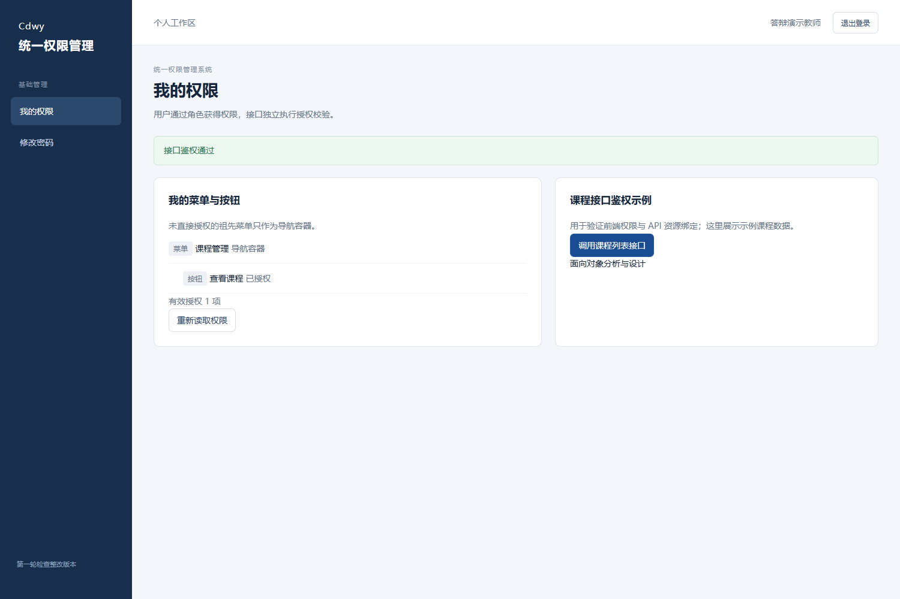

# 当前设计图与界面

类图与顺序图按已安装的uml-class-sequence-diagrams skill生成。脚本核对当前源码类与方法、Service居中、类框不重叠、连线不穿无关类框；顺序图检查独立调用激活条及箭头端点。七张PNG均已实际打开检查。

核心ER是单独的概念建模，不套用类图skill的Service布局规则。

| 图 | PNG | SVG | 代码／用途 |
|---|---|---|---|
| 登录服务类图 | [PNG](images/class-auth.png) | [SVG](images/class-auth.svg) | [AuthService](../../src/main/java/com/cdwy/permission/service/auth/AuthService.java)，区分JWT与账号核验 |
| 前端权限与API类图 | [PNG](images/class-permission.png) | [SVG](images/class-permission.svg) | [PermissionService](../../src/main/java/com/cdwy/permission/service/permission/PermissionService.java)，展示独立资源绑定 |
| 登录成功顺序图 | [PNG](images/sequence-login.png) | [SVG](images/sequence-login.svg) | MVC→Controller→AuthService，查询、BCrypt、JWT、静态UserViews映射 |
| 请求鉴权顺序图 | [PNG](images/sequence-authorize.png) | [SVG](images/sequence-authorize.svg) | [ApiAccessConfig](../../src/main/java/com/cdwy/permission/config/ApiAccessConfig.java)注册的拦截器在业务Controller之前执行 |
| 密码错误顺序图 | [PNG](images/sequence-password-failure.png) | [SVG](images/sequence-password-failure.svg) | AuthService抛异常，MVC调用[ApiExceptionHandler](../../src/main/java/com/cdwy/permission/controller/common/ApiExceptionHandler.java)转为401 |
| 六类核心概念ER | [PNG](images/er-core.png) | [SVG](images/er-core.svg) | 用户、角色、前端权限、API资源、应用、部门；不把JWT当实体 |
| 全10表物理ER | [PNG](images/er-physical.png)／[Mermaid源](physical-er.mmd) | [SVG](images/er-physical.svg) | 包括sys_account与三张关联表，12外键 |

类图只展示当前场景相关成员，不声称列出每个类所有字段。顺序图按场景省略构造器和框架代理。内部调用者是MVC分发器，图中Token/ResponseEntity由MVC转成HTTP响应；未画成浏览器直接调用Java对象。

## 重新生成

```powershell
python scripts/build-review-diagrams.py
```

需要Pillow与可显示中文的字体（本机使用Windows微软雅黑）。脚本从同一几何数据生成PNG和SVG，校验输出为[diagram-validation.json](diagram-validation.json)。修改源码后需核对参与者和调用顺序，再重新生成和目视检查。

## 实际浏览器验证截图

浏览器在隔离的H2内存库创建示例数据，15项界面操作通过，无JavaScript异常；不是已部署服务器的截图。记录见[ui-verification.json](ui-verification.json)。

- [登录](images/ui-login.png)
- [菜单与按钮](images/ui-permissions.png)
- [API资源](images/ui-resources.png)
- [三组授权关系](images/ui-grants.png)
- [普通用户权限树与课程接口结果](images/ui-my-permissions.png)


